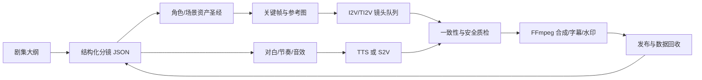

# 单人全栈做 AI 漫剧：2026 年可执行创业方案

> 面向：一名能独立完成产品、后端、工作流和部署的技术创始人。  
> 最终审查更新：2026-10-04。本文的市场数据来自第三方行业监测或报告，模型能力以官方仓库为准；它们不是收入保证。

## 对 `fangan.md` 的最终审查

`fangan.md` 的方向判断有三点值得吸收：

- **把内容线降级为验证、获客和数据来源**，不把爆款收入写进商业计划；工具和 B 端承制才是可控现金流方向。
- **把合规留痕、模型路由、VLM 预审做成产品能力**。这比单纯拼一个视频 API 聚合器更贴近工作室的真实生产问题。
- **明确剧本是人工瓶颈**。第一批样片应预留预算请编剧/导演型合作者做节拍和对白润色，而不是只优化提示词。

但下列说法未在本次核验到的法规或厂商一手资料中得到支持，已不作为本方案的实现规格：`片头前 3 秒`、`标识宽度 5%`、`AI 占比大于 50%`、`30/80 万元分类阈值`、`个人一定无需许可证`、`原著截取 10%`、`单集至少 30 秒`、指定的“过审率/爆款率/承制方数量”、以及具体下架个案。它们可以作为待向**目标平台运营和专业律师逐项确认**的假设，不能直接写进自动化规则。

可确认的底线是：广电总局令第 16 号已于 2026-09-01 施行，微短剧按一、二、三类管理；一类/二类和三类的审核、材料与播出责任并不相同，正式路径必须以目标播出平台和主管部门给出的当前入口为准。网信办的 AI 标识办法要求视频等生成合成内容采用显式与文件元数据中的隐式标识；视频显式标识应在起始画面或播放周边的适当位置呈现。它没有给出上述“3 秒/5%/50%”统一阈值。

## 结论先行

现在 AI 漫剧最热的并不是单一“文生视频模型”，而是下面四项能力组合：

1. **参考图驱动的图生视频（I2V/TI2V）与角色一致性**：先固化人物、服装、场景资产，再为每个镜头生成 3--6 秒视频。它比让模型从长文本直接生成整集更可控。
2. **音频驱动角色表演（S2V / Animate）**：先定对白和节奏，再让角色做口型、表情、动作。Wan2.2 已开源 S2V-14B 和 Animate-14B；这是目前最值得关注的“把静态漫剧变成动态短剧”的方向。
3. **低成本高分辨率推理**：Wan2.2 的 TI2V-5B 同时支持文生/图生视频、720P/24fps；官方称单张消费级显卡生成 5 秒 720P 可低于 9 分钟。MoE、量化、缓存和高压缩 VAE 让小团队能实际排产，而不只是试玩模型。
4. **可复用生产流水线**：剧本结构化、分镜、资产圣经、镜头队列、自动质检、字幕/剪辑和版本追踪。真正的壁垒在稳定地把 100 个镜头交付出来，不在于会调用一次模型。

赛道确实热，但供给也极度拥挤。DataEye 口径的公开转述显示，2026 年前 5 个月抖音新上 AI 剧/漫剧约 22.19 万部，破亿播放率约 0.48%，以 5,000 万播放为盈亏平衡线的剧集约占 1.3%。因此，不建议把“批量生成漫剧”当作产品定位；更合理的是用一部自有小样验证内容，再把内部流水线产品化。

## 适合单人的切入

### 推荐路径：内容试验场 -> 垂直生产工具

第一阶段做一个**单题材、原创或已明确授权 IP 的竖屏短季**，并同时沉淀内部系统；第二阶段才面向 3--5 个小工作室试售“角色资产 + 分镜到成片 + 审片 + 合规包”的生产工作台。可把不含客户素材和密钥的通用 adapter、任务协议或合规导出器开源，用于验证开发者需求；不要把开源 star 当作产品市场验证。

这个路线比直接做 C 端“AI 漫剧一键生成器”更适合你：

- C 端工具会直接与平台自带工具、ComfyUI 工作流和大厂模型竞争，获客昂贵且同质化。
- 纯内容工作室的核心竞争会落在编剧、导演和投流，而非你的全栈优势。
- 生产工作台能把你的优势变成可量化指标：角色漂移率、镜头一次通过率、每有效秒成本、从剧本到首版耗时。

**第一季约束**：只选一个受众、一个美术风格、2 个主角色、4 个常驻场景；做 8--12 集、每集 45--90 秒的竖屏连续故事。每集结尾只有一个强悬念。不要第一季就做 20 分钟长集、多人群像、写实战争或复杂打斗。

题材应从你能持续供给的原创强钩子中选，而不是购买未授权网文后“先做再说”。例如“新中式怪谈解谜”“职场轻悬疑”“女性成长幻想”都比泛玄幻模板更易形成账号识别度。先用 10 条冷启动内容验证题材；不要先采购大 IP。

## 技术选型

不要自行训练视频基础模型，也不要在 MVP 期把所有模型都本地化。采用“**云端质量基线 + 本地可替换 worker**”的双轨方式：云 API 用来迅速完成 A/B 样片；开源模型用于成本、隐私和供应商风险验证。你的应用只依赖自己的 `GenerationProvider` 接口，绝不把某个 ComfyUI 工作流或某家 API 写死在业务代码里。

| 层级 | MVP 推荐 | 为什么 | 不建议/注意 |
|---|---|---|---|
| 剧本与分镜 | 任一可靠 LLM API，严格 JSON Schema 输出 | 用于节拍、镜头、角色状态、提示词和审核，而不是替代编剧 | 每集必须人工改“前 3 秒钩子”和结尾悬念 |
| 角色/场景关键帧 | Qwen-Image（具体 checkpoint 单独核许可）或付费图像 API | 高质量设定图、修图、中文文字元素；每角色保存固定正/侧/表情/服装参考 | 不要只存 prompt；参考图、seed、模型版本都要入库 |
| 云端质量基线 | **Seedance 2.5**，以实际可用 API/合同为准 | 官方公布单次可达 30 秒，并支持最多 30 图、10 视频、10 音频的多模态参考；适合测试长镜头、转场和多角色控制 | 不承诺 4K、价格或可用地区；在购买前以 API 控制台、SLA、数据与商用条款复核 |
| 云端成本对照 | **Vidu Q3** | 官方价格页清楚列出 3--16 秒、540P/720P/1080P 的参考生视频和图/文生视频价格，可作为预算基准 | 价格、离峰价和并发随套餐变动；每次实验都记录实付 credits |
| 本地视频基线 | **Wan2.2 TI2V-5B** | Apache-2.0；T2V/I2V 一体、720P/24fps、消费级 GPU 可跑，适合作为可控成本与供应商风险对冲 | 14B MoE 画质更强但单人 MVP 不要把它作为唯一产能 |
| 表演/口型 | Wan2.2 S2V-14B / Animate-14B；或有商用条款的云 API | 将声音、人物参考和动作拆开控制 | 不要直接把 Wav2Lip 放进商业产品：其官方仓库明确是非商业/研究用途 |
| 配音 | CosyVoice（核验所用权重及音色许可）或云 TTS | 中文、多语种和批处理都成熟；角色声线配置可资产化 | 不克隆真实人物声音；保留授权与同意记录 |
| 工作流试验与执行 | **ComfyUI** 用于原型、工作流版本管理和 API 调用 | 原生支持大量开源模型，有本地 API、异步队列和工作流复用能力 | 不把节点图当作产品 UI；对客户暴露“镜头任务”而不是节点 |
| 剪辑与交付 | FFmpeg + ASS 字幕 + Python/TypeScript 任务编排 | 可复现、无人工 NLE 阻塞、便于插入显式 AI 标识 | 音乐、字体、音效也必须可商用可追溯 |

### 模型不是单选题：用统一基准选主力

Seedance 2.5 代表当前“长片段、多参考、音画联合”的闭源能力方向；Wan2.2 则是开放、可本地部署的成本与供应风险基线。两者都不该凭宣传页直接指定为生产主力。第 1 周用同一套 20 个镜头，在相同角色资产、时长和验收标准下进行盲评，按以下加权分选一个主力、一个备份：角色一致性 35%、分镜遵从/转场 25%、音画质量 15%、单位有效秒成本 15%、平均交付时间与失败率 10%。

Wan2.2 官方仓库在 2026-10-04 约有 1.7 万 GitHub stars，并同时放出了 T2V、I2V、TI2V、S2V 和 Animate 模型及推理代码。其 TI2V-5B 使用 Apache-2.0，官方文档给出了 4090 上 5 秒 720P 的推理量级，适合做本地成本基线。

可同时保留两个备选：

- **HunyuanVideo-1.5**：8.3B 的轻量模型，官方称支持消费级 GPU，适合做质量对照；但要逐项阅读 Tencent Hunyuan Community License 的地域、下游分发和使用限制。
- **CogVideoX-2B**：Apache-2.0、硬件门槛低，适合做开发机回归测试；其视觉质量和能力完备性不应再作为新项目主力。

对于图像模型，Qwen-Image 的文本渲染、复杂编辑和社区生态很有价值；但 Qwen 不同版本的许可不同，例如 Qwen-Image-2.1 使用研究许可。因此“仓库开源”不等于“权重和输出可无条件商用”，每个具体 checkpoint 都要写入许可证清单。

## 产品架构：只做一个单体控制面

第一版不要拆微服务。推荐：

- 前端：Next.js + TypeScript，只有剧集、资产、镜头队列、审片四个页面。
- 控制面：FastAPI（或你最熟的 Node 后端）+ PostgreSQL；用 JSONB 存镜头规格与模型参数。
- 异步：Redis + Celery/Dramatiq/BullMQ 三选一。任务必须幂等，支持重试、取消、费用上限和失败原因。
- 计算：一个 GPU worker 容器运行 ComfyUI/API adapter；对象存储用 S3 兼容存储；CDN 仅用于预览成片。
- 可观测性：每个镜头记录 `prompt_version`、参考图 hash、模型/权重版本、seed、时长、GPU 秒数、人工评分和最终是否采用。

最重要的数据模型不是“作品”，而是可追溯的：

`Series -> Episode -> Shot -> GenerationRun -> AssetVersion -> ReviewDecision`

角色资产另设 `CharacterProfile`：服装、发型、年龄段、色板、禁用特征、声线、标准参考图和 LoRA/adapter 版本。它是角色一致性的唯一真源；提示词只是派生产物。

### 质检不要等到剪完

每个镜头生成 2--4 个候选，先做廉价的自动筛选：时长/分辨率、黑帧、NSFW/敏感内容、OCR 字幕冲突、主体相似度、角色脸部/服装偏移和视频运动异常；再由人工挑最终候选。多模态模型可作为“镜头是否符合分镜”的裁判，但不能自动放行。把人工审片的选择记录为训练数据，后期才有资格做偏好模型或 LoRA。

## 10 周验证计划

| 周次 | 交付物 | 成功门槛 |
|---|---|---|
| 第 1 周 | 题材定位、原创版权链路、角色/场景圣经、20 个镜头基准集 | 固定画风下主角色能被稳定识别；完成云端/本地模型盲评 |
| 第 2 周 | 分镜 JSON、资产库、至少两家云 API + Wan adapter、镜头队列 | 同一镜头可重跑且参数、成本、输出全可追溯 |
| 第 3 周 | 1 集完整样片与人工 QA、留痕导出器 | 从脚本到可发首版不超过 1 天；先向目标平台确认实际提审/发布路径 |
| 第 4--5 周 | 完成 8--12 集小季，封面、字幕、显式标识、账号素材 | 有连续叙事，不用“AI 炫技”替代钩子；无授权素材不得入片 |
| 第 6--7 周 | 发布合规版本，A/B 测开头、封面和节尾；复盘看板 | 找到显著优于自身基线的一种开头形式 |
| 第 8--9 周 | 与 3 家小工作室做问题访谈，按真实素材跑一次 demo | 至少获得一个可量化痛点和愿意尝试付费的信号 |
| 第 10 周 | 选择内容、工具或承制服务的一条主线 | 没有付费/复用证据就不扩展功能或购买更多 GPU |

应追踪的北极星不是播放量，而是：

- 内容：3 秒留存、完播率、下一集点击率、关注/播放比、评论中对人物和剧情的自然提及。
- 生产：有效成片秒数的总成本、镜头一次通过率、角色漂移率、人工审片分钟数。
- 商业：每个潜在工作室每周愿意付费节省的工时；而不是注册用户数。

停止条件也要预先写下：连续两个 10 条内容周期中，题材/开头 A/B 均没有改善留存，或一集的有效镜头通过率始终低到无法盈利，就停止扩产，先修改题材、剧本节拍或资产体系，不要继续加 GPU。

## 如果你说的“推荐模型”是个性化推荐系统

它应是另一个产品方向，**现在不建议与生产工具并行做**。冷启动没有版权内容池、行为数据和分发渠道，自己训练推荐模型不会产生优势。

若未来已经拥有合规内容和用户行为，按这个顺序演进：

1. 标签 + 热度 + 新鲜度 + 完播率的可解释规则排序；
2. 用剧本、封面、字幕生成 embedding 做召回，向量库检索候选；
3. 有足够曝光/播放/完播/付费日志后，再训练 two-tower 召回与 GBDT/Transformer 排序；
4. 做探索流量、去重、多样性、未成年人和低俗风险控制。

这时的护城河是你合法取得的行为数据和内容理解标签，而不是一个通用开源推荐模型。

## 合规和版权：上线前必须过的门

1. **IP 链路**：保存原创底稿，或取得小说改编、角色形象、音乐、字体、音色和第三方素材的书面授权。AI 不能消除改编权和肖像/声音权风险。
2. **模型许可台账**：对每个代码库、模型权重、LoRA、数据集、音色建立 `name/version/license/source/commercial-ok/restrictions/reviewed-at` 表。依赖树中有一个非商用组件就不能靠“主仓库 Apache”解决。
3. **AI 标识**：中国《人工智能生成合成内容标识办法》已于 2025-09-01 施行。视频需在起始画面或播放周边的适当位置提供显式标识，导出文件元数据还要有隐式标识；发布时主动声明使用 AI 生成内容。把水印、metadata 和生成日志做进导出器，而不是运营同学手工补。平台若另有更细的时长、位置、尺寸或材料规则，应以其最新书面规则覆盖本方案。
4. **创作留痕**：对每一个生成动作自动保存 request/response、参数、输入资产 hash、模型版本、操作者、时间戳和导出文件 hash；一键导出给平台/客户核验。这是可验证的工程能力，不应假定所有平台都要求同一种截图格式。
5. **人物和声音**：不使用公众人物或真实个人的脸、声音、动作素材；客户上传参考声/脸时，要求权利保证、保存同意证据，并设拒绝和删除流程。
6. **产品边界**：若对外提供“生成服务”而不仅是自己发布内容，尽早让熟悉网信、广电和著作权业务的律师审查服务形态、协议、日志留存和可能的备案/评估义务。本文不是法律意见。

## 有依据的项目清单

- [Wan2.2 官方仓库](https://github.com/Wan-Video/Wan2.2)：T2V/I2V/TI2V/S2V/Animate、Apache-2.0、部署说明和官方性能描述；是本文主推视频基线的主要依据。
- [Seedance 2.5 官方发布](https://seed.bytedance.com/en/blog/one-take-creation-flexible-referencing-introducing-seedance-2-5)：30 秒生成、多轮延展与多模态参考能力；是把闭源长镜头能力纳入首轮测试的依据。
- [Vidu API 官方价格页](https://platform.vidu.com/docs/pricing)：Q3 各分辨率、时长和能力对应的动态 credits 定价；预算应以此类实时价格页和实际账单为准。
- [ComfyUI 官方仓库](https://github.com/Comfy-Org/ComfyUI)：节点工作流、队列、API 与广泛模型支持；适合作为内部执行层而非最终产品界面。
- [HunyuanVideo-1.5 官方仓库](https://github.com/Tencent-Hunyuan/HunyuanVideo-1.5)：轻量开源视频模型的备选；其功能与消费级 GPU 定位来自官方说明。
- [HunyuanVideo-Avatar 官方仓库](https://github.com/Tencent-Hunyuan/HunyuanVideo-Avatar)：音频驱动多人角色动画的技术参考；同时须阅读其社区许可证和地域限制。
- [Qwen-Image 官方仓库](https://github.com/QwenLM/Qwen-Image)：图像生成、编辑和文字渲染参考；不得把该链接替代为具体权重的商用许可审查。
- [CosyVoice 官方仓库](https://github.com/FunAudioLLM/CosyVoice)：多语种语音生成、训练与部署能力的参考。
- [Wav2Lip 官方说明](https://github.com/Rudrabha/Wav2Lip)：明确仅个人/研究/非商业用途，是不应直接接入商业 MVP 的反例。
- [DataEye 行业数据公开转述](https://finance.sina.cn/2026-08-17/detail-ininqaqz7360972.d.html)：供给量与爆款比例的风险依据；这是第三方监测口径，不应作为融资预测的唯一数据源。
- [艾媒 2025--2026 AI 漫剧趋势白皮书](https://www.iimedia.cn/c400/108457.html)：行业把“画风统一、配音质感、角色塑造”列为关键质量挑战，与本方案优先做资产和审片系统的判断一致。
- [网信办《人工智能生成合成内容标识办法》](https://www.cac.gov.cn/2025-03/14/c_1743654684782215.htm)：中国发布、导出和传播 AI 生成内容的标识要求。
- [广电总局《微短剧发展管理办法》](https://www.nrta.gov.cn/art/2026/7/31/art_113_73785.html)：2026-09-01 生效的微短剧分类、备案、审核和播出责任规则。

## 下一步只做三件事

1. 用 Wan2.2 TI2V-5B、Seedance 2.5 和 Vidu Q3（以可用账号为准）对同一份 20 镜头分镜做盲评，记录质量、通过率和单位有效秒成本。
2. 为原创小季建立角色/场景资产圣经、许可证台账、可追溯镜头表与合规导出器，不先写面向客户的大产品。
3. 在第 3 周前向目标平台确认当前的提审、发布和材料要求；完成小季后访谈工作室，根据留存与付费信号决定是内容、工具还是承制服务。
